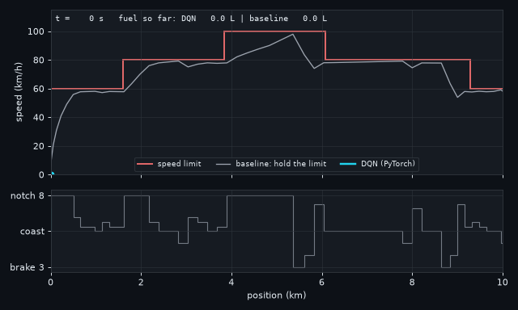
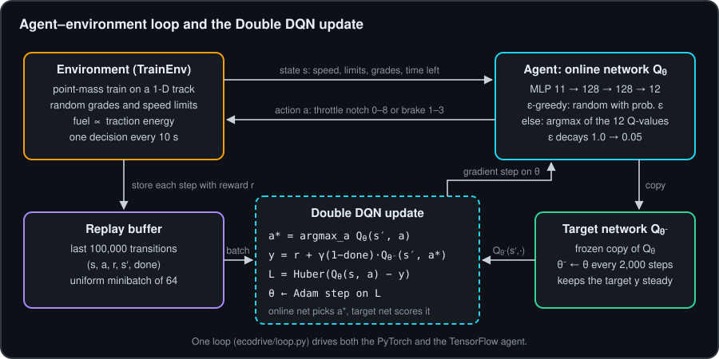
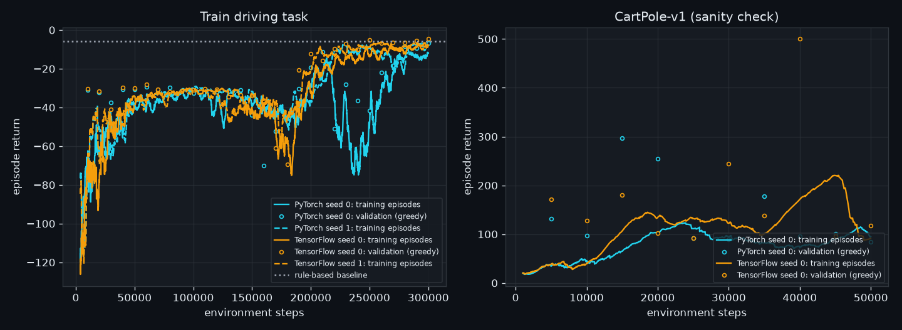
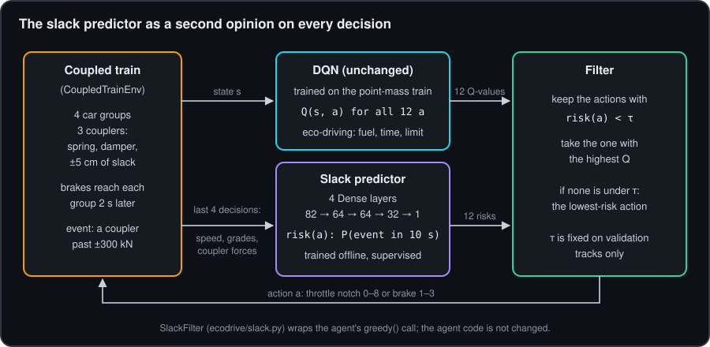
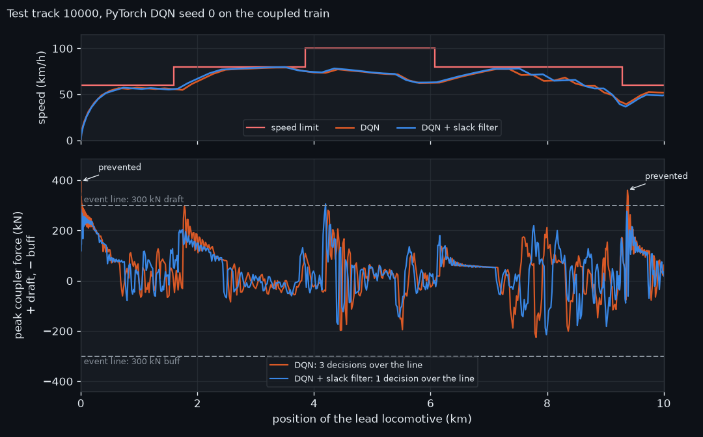
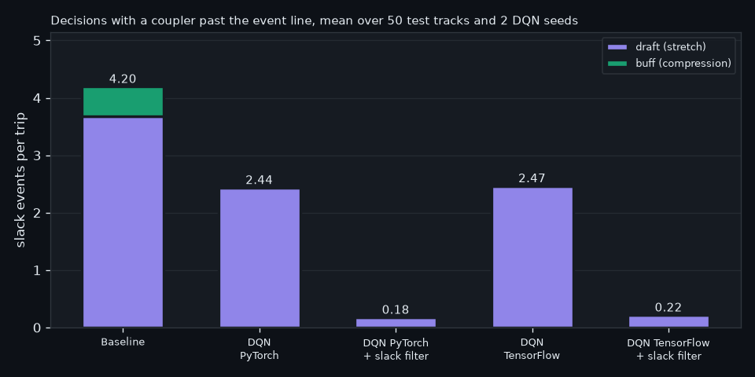
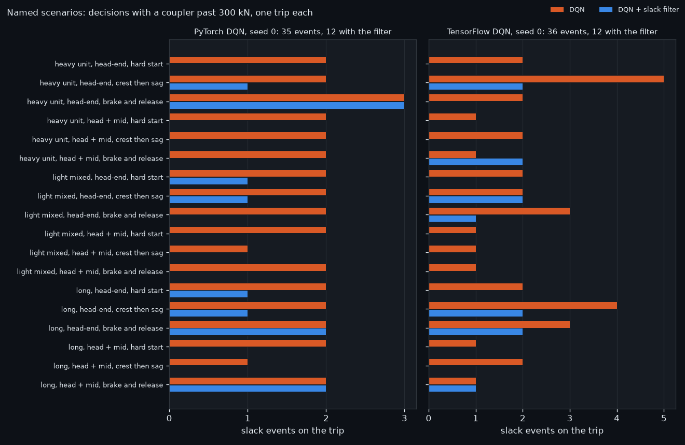

# Train eco-driving with Deep Q-Networks

A Double DQN agent drives a simulated 1,000 t train over a 10 km track. It has to arrive inside a
time window, stay under the speed limit and burn as little fuel as it can. The agent is implemented twice,
once in PyTorch and once in TensorFlow/Keras. Both sit on the same environment, replay buffer,
config and training loop, so the two files can be read side by side.

On 50 test tracks, averaged over two training seeds, the PyTorch agent used **31.5 % less
fuel** than a rule-based driver that holds the speed limit and arrived on time on **99 %** of the
tracks. The TensorFlow agent saved 24.8 % and arrived on time on 95 %. The next step is
to make the speed limit a hard constraint; the numbers and the history are below.

A second part puts the same agents on a train of four car groups joined by couplers with slack, and
adds a supervised [slack predictor](#slack-predictor-a-safety-filter) that vetoes actions likely to
snatch or run in the slack. On the same 50 test tracks it cut slack events from **2.4 to 0.2 per
trip** (−91 % to −93 %) and the mean peak coupler force from 388 to about 285 kN, for 0.4–0.5 % more
fuel and 3 points less on-time arrival. On 18 named scenarios (three train types, head-end and
mid-train power, three operating moves) it cut slack events from 35 to 12 (PyTorch) and from 36 to 12
(TensorFlow).



*Test track 10003, PyTorch agent (seed 0). Top: speed against the limit (red), DQN in cyan, the
baseline in grey. Bottom: the notch or brake level picked at each 10 s decision.*

## Why this problem

Fuel-efficient driving is a sequential decision problem. A notch chosen now changes the speed, the
time left and the fuel for the rest of the trip, and the right choice depends on what lies ahead: a
climb, a descent, a lower limit, the deadline. "Hold the limit" is safe and punctual. It also spends
kinetic energy that the next lower limit throws away in the brakes, and it never uses the slack in
the timetable. Those are the two gaps a learned policy can go after.

## The environment

`ecodrive/env.py` is a point-mass train with textbook physics and a Gymnasium API:

```
m dv/dt = F_traction − F_brake − (A + B v + C v²) − m g · grade
F_traction = notch/8 · min(F_max, P_max / v)        fuel = SFC · ∫ F_traction · v dt
```

Each reset draws a new track from the seed: grades between −0.6 % and +0.6 % in 0.6–1.5 km pieces,
and limits of 60, 80 or 100 km/h in 1.5–3.5 km pieces. The agent decides every 10 s and the physics
runs at 1 s inside that step. A trip takes about 55–70 decisions.

| | |
|---|---|
| **State** (11 floats) | speed; current limit; next limit and the distance to it; grade here; mean grade over the next 1 km; distance left; elapsed time; average speed still needed; schedule slack; last control level |
| **Actions** (12) | throttle notch 0–8 (0 = coast) or brake level 1–3 |
| **Reward** per decision | −0.1 per litre of fuel, −5 per m/s over the limit, −0.05 × the change in control level (full brake = −1, full notch = +1) |
| **At arrival** | −5 per minute outside the window [1.05, 1.40] × free-flow time, and −10 more if late at all |
| **Hard stop** | at 1.70 × free-flow time: −10 × the share of track still ahead, plus the lateness terms |

Free-flow time is the trip at exactly the limit everywhere. Schedule slack is the time left before
the deadline minus the free-flow time of the track still ahead: once it goes negative, the train can
no longer make it.

The baseline (`ecodrive/baseline.py`) is a cruise control that knows the train's physics. It aims
0.5 m/s under the limit, picks the notch that balances resistance and grade, and starts braking two
decisions before it needs to for a lower limit. On all 50 test tracks it arrived on time with zero
limit violations, at 1.20 × free-flow time on average.

## The algorithm



Plain DQN with the usual stabilisers:

- **Experience replay**: a 100k ring buffer in numpy (`ecodrive/replay.py`), uniform batches of 64.
- **Target network**: a frozen copy, hard-synced every 2,000 environment steps.
- **Double DQN**: the online network picks the next action and the target network scores it. This
  takes out most of the max-operator overestimation.
- **Huber loss** (δ = 1) and a global gradient-norm clip of 10.
- **ε-greedy**, linear from 1.0 to 0.05 over 100k steps.
- **One seed** for tracks, exploration, replay sampling and weight init.

Both backends use the same settings: Adam at 5e-4 (ε = 1e-7), an MLP 11 → 128 → 128 → 12 with Glorot
initialisation, one gradient step every two decisions, 300k environment steps (about 4,000 trips).
Every 10k steps the greedy policy plays 30 validation tracks (seeds 1000–1029) and the best weights
are kept. Test tracks start at seed 10000 and only `evaluate.py` touches them.

## Results

`evaluate.py --seeds 0 1` on test seeds 10000–10049. Each cell is the mean over two training seeds,
with the per-seed range in brackets. Raw numbers are in `results/eval_train_*.json`.



| 50 test tracks, 2 seeds | DQN, PyTorch | DQN, TensorFlow | Baseline |
|---|---|---|---|
| Fuel (L) | **33.7** [32.0, 35.4] | 37.0 [37.0, 37.1] | 49.2 |
| Fuel saving vs baseline | **31.5 %** [28.1, 35.0] | 24.8 % [24.7, 24.9] | |
| On time | **99 %** [98, 100] | 95 % [90, 100] | 100 % |
| Decisions over the limit, per trip | 0.31 [0.16, 0.46] | **0.10** [0.04, 0.16] | 0 |
| Trip time / free-flow time | 1.30 [1.29, 1.32] | 1.30 [1.27, 1.32] | 1.20 |
| Control changes, per trip | **24.2** | 26.9 | 30.3 |
| Episode return | −5.24 [−6.38, −4.10] | **−4.99** [−5.50, −4.48] | −5.92 |

Both agents found the same policy: accelerate less hard, cruise below the limit, coast into lower
limits, and spend some of the timetable slack. They use about 8 % more trip time than the baseline
(1.30 against 1.20 × free-flow), still well inside the window, and change notch less often.

The speed limit is the next target. The PyTorch agent goes over on 0.31 decisions per trip
on average. The TensorFlow agent gets to 0.10, but one of its seeds arrives late on 5 of the 50
tracks. The baseline never does either, because it plans its braking with the train's physics; the
agent has to learn that from the reward alone.

The track in the GIF is a typical one (28 % saving, on time, no overshoot). The last 1.5 km is where
the most room is left: the agent switches quickly between brake 1 and low notches while it lines
up the final limit and the arrival.

### How the results developed

Tuning took two passes, about 36 minutes and 47 minutes of CPU training. Every number below comes from
the same 50 test tracks. Settings were chosen on validation return, but these test-track numbers were also
read between rounds, so the tracks are not untouched; a fresh seed range would give a clean held-out test.

**First pass** (150k steps, one seed, 10 validation tracks, no schedule-slack input, Adam at 5e-4,
target sync every 1,000 steps):

| Setting | Backend | Fuel saving | On time | Over the limit / trip |
|---|---|---|---|---|
| −0.5 per m/s over, −2 per minute late | PyTorch | 47.0 % | 84 % | 0.54 |
| Same, plus −1 flat per decision over and −5 per minute late | PyTorch | diverged, stopped at 140k | | |
| −0.5 per m/s over, −5 per minute late | PyTorch | 37.6 % | 62 % | 0.40 |
| −0.5 per m/s over, −5 per minute late | TensorFlow | 17.5 % | 36 % | 2.28 |

The agents were buying fuel with lateness. They aimed at the late edge of the window and, with 10 s
decisions, landed past it on 16 % to 64 % of the tracks.

**Second pass** (300k steps, two seeds, 30 validation tracks):

- **Round A**: added the schedule-slack input and the flat −10 for any late arrival, and raised the
  limit penalty to −2 per m/s. Lateness was fixed in one step: all four runs were on time on 98–100 %
  of the tracks. But two of the four runs diverged. Their TD loss climbed from about 0.1 to 2 and to 17,
  and the limit overshoots went up to 3.5 per trip.
- **Round B**: Adam at 3e-4, target sync every 2,000 steps, −5 per m/s over the limit. Stable, but
  most runs only started to learn after 200k steps, and on time fell to 54–96 %.
- **Round C**: back to 5e-4, keeping the slower target sync and the −5. TensorFlow reached the table
  above. PyTorch was clearly behind (78 % on time).
- **Round D**: the PyTorch and Keras defaults were not the same. `nn.Linear` starts from Kaiming-uniform
  weights with non-zero biases, Keras `Dense` from Glorot-uniform with zero biases, and Adam's ε is
  1e-8 against 1e-7. Matching the PyTorch agent to the Keras defaults and retraining only the PyTorch
  seeds fixed it: their best validation returns went from −10.5 and −10.8 to −6.9 and −4.0, and on time on the
  test tracks went from 78 % to 99 %.

The final setting was picked by mean validation return, not by test results. Scaling
the rewards down was left out: with Adam it mostly acts like raising the learning rate, which was the
wrong direction here.

### Sanity check: CartPole-v1

Same code and loop, 50k steps, Adam at 1e-3, target sync every 500 steps, one seed, 50 test episodes:

| | Mean return | Min |
|---|---|---|
| PyTorch | 304.8 ± 52.5 | 252 |
| TensorFlow | **500.0** ± 0.0 | 500 |

TensorFlow's best checkpoint holds the pole for the full 500 steps on every test episode. DQN on
CartPole swings a lot during training, as both curves show, and a single seed says little about which
backend is better here.

### What is next

- Treat the speed limit as a hard constraint: mask the actions that cannot keep the train under the
  next limit, using the same braking model the baseline uses. That should take the overshoots to zero.
- Shorter decisions (5 s) near limit changes and at the end of the trip, where the 10 s steps are too
  coarse.
- More seeds. Two per backend shows the spread but not a reliable ranking of the frameworks.
- A terminal stop at the platform, so the arrival is a real stopping problem.

## Slack predictor (a safety filter)

All data here is synthetic, generated by this repo's simulator; none of it comes from any employer.

**Slack** is the free play in the couplers between freight cars. When the locomotive pulls hard and
suddenly, the cars at the front move before the ones behind and the slack runs out: the train
stretches, a **draft** event. When the front slows first, under braking or at the bottom of a
descent, the cars behind run into it: the train compresses, a **buff** event. Either one can put a
large force through a coupler. A driving policy that only sees speed, grades and time cannot see
this coming.

This part mirrors, on synthetic data, the design of a slack predictor used next to a driving-strategy
model in train control: a supervised sequential network, trained offline, that gives the driving
model a safety filter that blocks an action predicted to cause a serious slack event. It is
checked the same way, by running the same train on the same tracks with and without it.

### The coupled train

`ecodrive/coupled.py` adds `CoupledTrainEnv`, an opt-in subclass. `TrainEnv` and every number above
are unchanged; the only edit to `env.py` moves the physics loop into a method the subclass replaces.
The observation (11 floats) and the actions (12) stay the same, so the DQNs trained above drive it
as they are.

```
m_i dv_i/dt = F_traction (lead only) − F_brake,i − R_i(v_i) − m_i g grade(x_i) + F_{i−1} − F_i
F_j = k (d_j ∓ gap) + c ḋ_j   once the stretch d_j is past ±gap, else 0      (+ draft, − buff)
```

| | (all values invented for this repo) |
|---|---|
| Car groups | 4 × 250 t, 200 m apart; the locomotive force acts on the lead group, each group feels the grade under itself |
| Couplers | spring k = 2 MN/m, damper c = 150 kN·s/m, ±5 cm of free slack |
| Brakes | the brake force is shared by mass and reaches group i 2·i seconds after the command, so the front slows first |
| Integration | 0.1 s inside each 1 s physics substep; the coupler force is recorded every substep |
| Slack event | a decision (10 s) in which any coupler goes past 300 kN, draft and buff counted separately |

Held at a steady pull, coupler j carries the traction share of the mass behind it (3/4, 2/4, 1/4),
about 225 kN at most. Only a sudden change pushes a coupler past 300 kN. The most common one in this
model is notch 8 from a standstill: the slack snatches tight and the first coupler peaks near 400 kN.

### Data, model and metrics

Six policies drive every track: the PyTorch DQN (seed 0) as trained, the same with 20 % random
actions, seed 1 with 40 %, the baseline, the baseline with 30 %, and uniform random. Each decision
becomes one row: the last 4 decisions of 17 features each (speed, limit, grade at the head and at the
rear of the train, mean grade over the next 1 km, the last control level, the force in each coupler,
the peak draft and buff over the last decision, where each coupler sits in its slack and how fast it
is closing), plus the candidate action (one-hot, its control level and the change from the last one).
The label is whether a slack event happens during that decision.

The split is by track, on the repo's seed ranges, with no track in two splits:

| Split | Track seeds | Rows | Rows with an event |
|---|---|---|---|
| Train | 20000–20199 | 76,852 | 10.0 % |
| Validation | 1000–1049 | 18,933 | 10.0 % |
| Test | 10000–10049 | 19,154 | 9.8 % |

The predictor is a 4-layer feed-forward network over the flattened window, 82 → 64 → 64 → 32 → 1,
written twice: `ecodrive/predictor/torch_slack.py` (`nn.Sequential`) and `ecodrive/predictor/tf_slack.py`
(`keras.Sequential`), with the same methods in the same order. The inputs are standardised on the
training split. Training uses Adam at 1e-3, batches of 256, and cross-entropy with positives
weighted 9.0 × (the negative-to-positive ratio) against the imbalance. 30 epochs were run and the
epoch with the lowest validation loss was kept: epoch 7 for both backends. After that the validation
loss rises while the training loss keeps falling, so early stopping at epoch 7 keeps the best
generalising weights.

The decision threshold τ is set on the validation split only: the highest τ that still flags 90 %
of the validation events. With weighted training the scores run high, so τ lands at 0.885 (PyTorch)
and 0.928 (TensorFlow). On the test split:

| Test split, 19,154 rows | PyTorch | TensorFlow |
|---|---|---|
| Threshold τ (from validation) | 0.885 | 0.928 |
| Precision | 0.919 | 0.920 |
| Recall | 0.903 | 0.904 |
| F1 | 0.911 | 0.912 |
| ROC-AUC | 0.997 | 0.997 |
| Confusion matrix (TP / FP / FN / TN) | 1,698 / 150 / 183 / 17,123 | 1,701 / 147 / 180 / 17,126 |

Two things make this test easier than a real train. About two thirds of the DQN's events (95 of 145 on the test tracks)
are the first two decisions from a standstill, which are easy to predict. And the inputs include the
coupler stretch and closing speed, which the simulator knows exactly and a real train does not
measure.

### The filter



`SlackFilter` in `ecodrive/slack.py` wraps an agent and has the same `greedy(obs)` call. At each
decision it takes the DQN's 12 Q-values and the predictor's 12 risks, one per candidate action, and
returns the highest-Q action with risk below τ. If all 12 are at or above τ, it returns the
lowest-risk one. The agent code is not changed.

### A/B on the test tracks

The coupled train on test tracks 10000–10049, the same tracks and the same seeds in every column.
Each DQN cell is the mean over two training seeds, with the per-seed range in brackets; each backend
uses its own predictor. Raw numbers are in `results/slack_ab_*.json`.

| 50 test tracks, 2 seeds | DQN, PyTorch | + slack filter | DQN, TensorFlow | + slack filter | Baseline |
|---|---|---|---|---|---|
| Draft events, per trip | 2.44 [1.98, 2.90] | **0.18** [0.06, 0.30] | 2.46 [2.34, 2.58] | **0.22** [0.18, 0.26] | 3.68 |
| Buff events, per trip | 0 | 0 | 0.01 [0, 0.02] | 0 | 0.52 |
| Slack events, all 100 trips | 244 | **18** | 247 | **22** | 210 (50 trips) |
| Trips with any event | 100 of 100 | 17 of 100 | 100 of 100 | 21 of 100 | 50 of 50 |
| Peak coupler force per trip, mean (kN) | 388 | **285** | 388 | **287** | 402 |
| Highest peak on any trip (kN) | 459 | 360 | 470 | 339 | 451 |
| Fuel (L) | 32.9 [31.3, 34.5] | 33.0 [31.4, 34.7] | 36.2 [35.8, 36.5] | 36.3 [36.3, 36.3] | 48.1 |
| On time | 100 % | 97 % [96, 98] | 95 % [90, 100] | 92 % [86, 98] | 100 % |
| Decisions over the speed limit, per trip | 0.51 [0.26, 0.76] | 0.49 [0.28, 0.70] | 0.29 [0.28, 0.30] | 0.31 [0.30, 0.32] | 0.20 |
| Decisions the filter changed, per trip | | 2.5 [2.0, 2.9] | | 2.6 [2.5, 2.7] | |

With the filter, slack events fell by 93 % (PyTorch) and 91 % (TensorFlow), and the mean peak
coupler force dropped by about 100 kN, to under the 300 kN line on the average trip. Fuel went up by
0.4 % to 0.5 %. The trade-off is in the timetable: on time moved by 3 points for both backends, from 100 %
to 97 % and from 95 % to 92 %. The filter changes about 2.5 decisions per trip, mostly by notching up
in steps at the start instead of going straight to notch 8 (on the first 20 test tracks, 33 of the
PyTorch seed-0 run's 55 changes fall in the first three decisions, and 47 replace notch 8 with notch
4 to 7), and the DQN, which already runs close to
the late edge of the window, has not yet learned to win that time back. Speed-limit overshoots did not change.
40 events remain over 200 filtered trips, from events the predictor
misses (it catches 90 % on the test split) and from situations its own choices lead into.



*Test track 10000, PyTorch DQN seed 0. Top: speed. Bottom: the larger of the draft (+) and buff (−)
peaks in each second. Without the filter the DQN crosses the 300 kN line in three decisions, two at
the start and one at 9.4 km, where it notches up right after releasing the brake. With the filter it crosses once, at 4.2 km, at
306 kN, in a place where the plain run stayed under the line.*



### Scenario A/B

All data here is synthetic too, from this repo's simulator; none of it comes from any employer.

The A/B above runs on random tracks. This one follows the way a slack predictor is validated in a
lab: named scenarios, each a train type, a power setup and a short track section with one operating
move, run once without the filter and once with it. `ecodrive/scenarios.py` defines 18 of them: every
train type with both power setups on all three sections.

| Train type (all values invented) | Mass | Length | Coupler k, c | Free slack | Traction | Timetable |
|---|---|---|---|---|---|---|
| Heavy unit | 4 × 500 t | 800 m | 3.0 MN/m, 260 kN·s/m | ±5 cm | 1.1 units, 330 kN | 1.3 × |
| Light mixed | 4 × 150 t | 800 m | 1.5 MN/m, 100 kN·s/m | ±10 cm | 1 unit, 300 kN | 1.1 × |
| Long | 4 × 375 t | 1.4 km | 1.2 MN/m, 140 kN·s/m | ±12 cm | 1.1 units, 330 kN | 1.2 × |

- **Power setups.** *Head-end*: all the traction on the lead group. *Head + mid*: two thirds on the
  lead group and one third on the third group, like a mid-train locomotive.
- **Timetable.** The arrival window and the hard stop are 1.1 to 1.3 times the reference train's, so
  the heavier and longer trains have a schedule they can keep.
- **Sections**, 6 km each, with one grade g. *Hard start*: a standing start on a g upgrade for 2 km,
  then level, at 80 then 100 km/h. *Crest then sag*: up g to a crest at 2.5 km, down g into a sag at
  3.7 km, up g again, at 80 km/h. *Brake and release*: down g with the limit dropping from 100 to 60 km/h
  at 3 km, then up g from 3.5 km with the limit back at 100 km/h from 3.6 km.
- **Calibration.** Each section's grade was set on the plain PyTorch DQN only, never with the filter:
  from 0.1 % to 1.5 % in 0.1 % steps, the grade whose trip arrives with a slack-event count nearest
  2. That gives 2 events in 15 of the 18 scenarios, 3 in one and 1 in two. The TensorFlow DQN drives
  the same scenarios without a calibration of its own, so its counts spread from 1 to 5.
- **Model changes, all opt-in.** `CoupledTrainEnv` takes the group mass and spacing, the coupler k,
  c and slack, the head and mid traction, a fixed track and a timetable stretch as arguments. With no
  arguments it is the train above, and `slack_predictor.py ab` reproduces `results/slack_ab_torch.json`
  byte for byte. Each train's damper keeps the damping ratio near the reference train's 0.15, which
  also keeps the 0.1 s integration stable; `tests/test_scenarios.py` checks that for every train. The
  group count stays at 4 because the predictor's inputs are sized for 3 couplers, and the predictor is
  the one trained above, on the reference train only.

Every scenario, DQN seed 0, without → with the slack filter. PyTorch in full, the TensorFlow event
counts in the last column. Raw numbers are in `results/slack_scenarios_*.json`.

| # | Train | Power | Section | Grade | Draft + buff events | Peak coupler force (kN) | Fuel (L) | Arrival (s) | TensorFlow: events |
|---|---|---|---|---|---|---|---|---|---|
| 1 | heavy unit | head-end | hard start | 0.6 % | 2 + 0 → 0 + 0 | 422 → 294 | 68.9 → 70.6 | 398 → 407 | 2 → 0 |
| 2 | heavy unit | head-end | crest then sag | 0.6 % | 2 + 0 → 1 + 0 | 460 → 306 | 51.0 → 51.5 | 370 → 375 | 5 → 2 |
| 3 | heavy unit | head-end | brake and release | 0.2 % | 3 + 0 → 2 + 1 | 492 → 383 | 58.1 → 52.6 | 385 → 391 | 2 → 0 |
| 4 | heavy unit | head + mid | hard start | 0.4 % | 1 + 1 → 0 + 0 | 356 → 207 | 66.1 → 61.9 | 399 → 384 | 1 → 0 |
| 5 | heavy unit | head + mid | crest then sag | 1.3 % | 1 + 1 → 0 + 0 | 338 → 278 | 61.6 → 64.1 | 398 → 395 | 2 → 0 |
| 6 | heavy unit | head + mid | brake and release | 0.6 % | 2 + 0 → 0 + 0 | 348 → 246 | 58.2 → 56.5 | 389 → 392 | 1 → 2 |
| 7 | light mixed | head-end | hard start | 0.4 % | 2 + 0 → 1 + 0 | 449 → 350 | 27.9 → 26.7 | 291 → 302 | 2 → 0 |
| 8 | light mixed | head-end | crest then sag | 0.5 % | 2 + 0 → 1 + 0 | 458 → 314 | 22.1 → 23.1 | 311 → 317 | 2 → 2 |
| 9 | light mixed | head-end | brake and release | 0.6 % | 2 + 0 → 0 + 0 | 353 → 296 | 29.3 → 28.5 | 342 → 351 | 3 → 1 |
| 10 | light mixed | head + mid | hard start | 0.7 % | 2 + 0 → 0 + 0 | 357 → 262 | 30.0 → 29.3 | 297 → 305 | 1 → 0 |
| 11 | light mixed | head + mid | crest then sag | 0.5 % | 1 + 0 → 0 + 0 | 325 → 216 | 23.4 → 22.3 | 312 → 317 | 1 → 0 |
| 12 | light mixed | head + mid | brake and release | 0.9 % | 2 + 0 → 0 + 0 | 325 → 208 | 29.3 → 30.2 | 344 → 347 | 1 → 0 |
| 13 | long | head-end | hard start | 0.6 % | 2 + 0 → 1 + 0 | 402 → 307 | 54.0 → 53.7 | 351 → 360 | 2 → 0 |
| 14 | long | head-end | crest then sag | 0.6 % | 2 + 0 → 1 + 0 | 431 → 331 | 39.9 → 36.7 | 344 → 347 | 4 → 2 |
| 15 | long | head-end | brake and release | 0.5 % | 1 + 1 → 1 + 1 | 358 → 358 | 50.2 → 50.2 | 368 → 368 | 3 → 2 |
| 16 | long | head + mid | hard start | 0.1 % | 2 + 0 → 0 + 0 | 336 → 272 | 47.4 → 47.1 | 333 → 339 | 1 → 0 |
| 17 | long | head + mid | crest then sag | 0.6 % | 1 + 0 → 0 + 0 | 308 → 266 | 39.9 → 42.7 | 343 → 353 | 2 → 0 |
| 18 | long | head + mid | brake and release | 0.5 % | 1 + 1 → 1 + 1 | 346 → 346 | 50.2 → 50.2 | 368 → 368 | 1 → 1 |

| 18 scenarios, one trip each | DQN, PyTorch | + slack filter | DQN, TensorFlow | + slack filter |
|---|---|---|---|---|
| Slack events, draft + buff | 35 (31 + 4) | **12** (9 + 3) | 36 (31 + 5) | **12** (6 + 6) |
| Scenarios with any event | 18 of 18 | 8 of 18 | 18 of 18 | 7 of 18 |
| Peak coupler force per trip, mean (kN) | 381 | **291** | 384 | **280** |
| Highest peak on any trip (kN) | 492 | 383 | 460 | 414 |
| Fuel, all 18 trips (L) | 807.7 | 798.0 | 764.1 | 777.3 |
| Arrival time, mean (s) | 352.4 | 356.6 | 355.2 | 361.1 |
| Arrived inside the window | 17 of 18 | 18 of 18 | 18 of 18 | 18 of 18 |
| Decisions over the speed limit, all trips | 17 | 26 | 4 | 10 |
| Decisions the filter changed, all trips | | 29 | | 40 |



On train types and power setups it never saw in training, the filter cut slack events by about two
thirds on both backends (35 to 12 and 36 to 12) and brought the mean peak coupler force down by 90 kN
(PyTorch) and 104 kN (TensorFlow). Every trip still arrived inside its window, about 4 to 6 s later on
average, and fuel moved by −1.2 % (PyTorch) and +1.7 % (TensorFlow).

- **Head + mid is where the filter does best.** With PyTorch it cleared every event in 8 of the 9
  head + mid scenarios. A mid locomotive already takes much of the pull off the front couplers.
- **Head-end trains keep a few events:** one each on the hard starts and crests of scenarios 2, 7, 8,
  13 and 14, and three on the heavy train's brake and release. With all the traction at the head, the
  first coupler carries the most and has the least margin.
- **Scenarios 15 and 18,** the long train braking and releasing, show the predictor's edge: the filter
  changed no decision there, so its risk score stayed under τ for the events on the long train's
  softer, looser couplers. These two are the first place to add training data from other train types.
- **Speed-limit overshoots rose,** from 17 to 26 decisions (PyTorch) and from 4 to 10 (TensorFlow) over
  the 18 trips. A filter that also guards the limit is on the list below.

### What is next for the predictor

- Inputs a real train has: locomotive speed and drawbar force, an end-of-train speed, the track
  profile. Dropping the coupler stretch and closing speed from the window will show how much of the
  0.997 ROC-AUC depends on knowing them.
- A longer horizon. The label covers one decision; an event caused by a brake release two decisions
  earlier is out of its reach.
- Train the DQN with the filter in the loop, or give it the slack risk in its reward, so it plans its
  time around the gentler starts and wins back the 3 points of on-time arrival.
- Training data from more train types and power setups, starting with the long train braking and
  releasing (scenarios 15 and 18 above), and the speed limit as a second thing the filter guards.
- More car groups and a nonlinear draft gear. Four lumped groups are enough to show run-in and
  run-out, not to put numbers on a real train.

## PyTorch vs TensorFlow

Same algorithm, same hyperparameters, same initialisation, same loop. Only
`ecodrive/agents/torch_dqn.py` and `ecodrive/agents/tf_dqn.py` differ, and they have the same methods
in the same order.

| | PyTorch | TensorFlow / Keras |
|---|---|---|
| Lines of code in the agent (no comments, docstrings or blank lines) | 54 | 52 |
| Network | `nn.Sequential` of `nn.Linear` + `nn.ReLU` | `keras.Sequential` of `Dense` |
| Initialisation | set explicitly to Glorot uniform, zero bias | Keras default (Glorot uniform, zero bias) |
| Q(s, a) of the taken action | `q.gather(1, a.unsqueeze(1))` | `tf.gather(q, a, batch_dims=1)` |
| Huber loss | `F.smooth_l1_loss` (β = 1) | `keras.losses.Huber(delta=1.0)` |
| Gradient step | `loss.backward()`, `clip_grad_norm_`, `opt.step()` | `GradientTape`, Adam with `global_clipnorm` |
| Speed-up | none needed, eager | `@tf.function` on the forward pass and the train step |
| Target sync | `load_state_dict(state_dict())` | `set_weights(get_weights())` |
| Wall time, train task, 300k steps | 506 s, 511 s | 585 s, 587 s |
| Wall time, CartPole, 50k steps | 145 s | 249 s |

The wall times are rough. Each process was capped at 4 threads on a 16-thread laptop CPU and ran at
idle priority while other work used the machine. The final TensorFlow runs shared the CPU with three
other training runs, and the final PyTorch runs with two. On a network this small the per-call overhead
dominates, not the arithmetic, so neither framework has a clear edge.

Versions: Python 3.13, PyTorch 2.14.1 (CPU), TensorFlow 2.21.0 (CPU) with Keras 3.15.1,
Gymnasium 1.4.0, NumPy 2.4.6.

## Run it

```bash
python -m venv .venv && source .venv/bin/activate      # Windows: .venv\Scripts\activate
pip install -r requirements.txt                       # CPU-only wheels

python train.py --backend torch --seed 0              # or --backend tf; repeat with --seed 1
python evaluate.py --backend torch --seeds 0 1        # DQN vs baseline on 50 test tracks
python train.py --backend tf --env CartPole-v1        # sanity check
python evaluate.py --backend tf --env CartPole-v1
python plots.py                                       # learning curves and the GIF

python slack_predictor.py data                        # coupled train: six policies on 300 tracks, labelled
python slack_predictor.py train --backend torch       # or --backend tf
python slack_predictor.py ab --backend torch          # DQN without vs with the filter, 50 test tracks
python slack_predictor.py scenarios --backend torch   # the same A/B on 18 named scenarios, DQN seed 0
python plots.py --slack                               # the slack figures
```

`train.py` writes weights, a per-episode `log.csv` and `summary.json` to `runs/<env>-<backend>-s<seed>/`.
`evaluate.py` writes `results/eval_<env>_<backend>.json`; `--trace-track` picks the test track that
`plots.py` animates. `--threads` sets the CPU threads (default 4).
`slack_predictor.py` needs the trained DQN weights in `runs/`. It writes the dataset to
`runs/slack-data.npz`, the predictor to `runs/slack-<backend>/` and the numbers to
`results/slack_*.json`. At 4 threads the dataset took 14 minutes, training under a minute per
backend, the A/B about 2 minutes per backend, and the scenario A/B 20 s (PyTorch) and 1 minute
(TensorFlow).

## Tests

`pytest -q` runs 68 tests in about a minute on a laptop CPU. GitHub Actions runs the same suite, with
both backends, on Python 3.11 (`.github/workflows/tests.yml`).

| File | What it checks |
|---|---|
| `tests/test_env.py` | speed never negative; position and fuel never decrease; coasting and braking burn no fuel; more notch, more fuel; resistance slows a coasting train; seeded resets repeat; free-flow time left shrinks to zero; the baseline is on time; standing still hits the hard stop |
| `tests/test_replay.py` | the size cap, overwriting the oldest entry, sample shapes and dtypes, rows staying whole, seeded sampling |
| `tests/test_agents.py` | per backend: the loss equals a numpy Double DQN + Huber reference; one update lowers the loss on its batch; the target network moves only on sync; save and load round-trip |
| `tests/test_loop.py` | updates start after warm-up, the target syncs on schedule, the ε schedule |
| `tests/test_smoke.py` | 400 real training steps per backend on both tasks, each well under 60 s |
| `tests/test_coupled.py` | the deadband passes no force inside the slack; spring and sign beyond it; couplers only move momentum between groups; a steady pull splits 3/4, 2/4, 1/4; the coupled trip matches the point mass within 5 %; full notch from a standstill is an event |
| `tests/test_scenarios.py` | 10 to 20 uniquely named scenarios covering every train, power setup and section; each one builds and runs one step; a fixed section ignores the seed; head + mid traction splits the pull 5/12, 2/12, 3/12; every train's coupler integration is stable |
| `tests/test_slack.py` | the three splits share no track; the input layout; the filter respects τ and never comes back empty; ROC-AUC, the confusion matrix and the threshold rule; per backend: forward-pass shapes and the weighted loss against numpy; a 2-trip smoke run of data, training and a filtered trip |

## Layout

```
ecodrive/
  env.py            train environment: physics, random tracks, reward
  baseline.py       rule-based driver that holds the limit
  replay.py         replay buffer (shared)
  config.py         hyperparameters (shared), env factory, epsilon schedule
  loop.py           training loop (shared)
  coupled.py        opt-in coupled train: car groups, couplers with slack, slack events
  scenarios.py      named slack scenarios: train types, power setups, fixed track sections
  slack.py          slack predictor inputs, dataset, training loop, metrics, SlackFilter (shared)
  agents/
    torch_dqn.py    Double DQN in PyTorch
    tf_dqn.py       Double DQN in TensorFlow/Keras
  predictor/
    torch_slack.py  slack predictor in PyTorch
    tf_slack.py     slack predictor in TensorFlow/Keras
train.py            train one backend on one task
evaluate.py         DQN vs baseline on test tracks
slack_predictor.py  slack dataset, predictor training, the A/B with and without the filter, the scenarios
plots.py            learning curves, the episode GIF, and the slack figures
results/            evaluation numbers and the recorded test episodes
assets/             README figures
tests/              pytest suite
```

## Author

Kamal Mehta, ML engineer. Built reinforcement learning for train control at Progress Rail, 2022–2026.
[kamal-mehta.com](https://kamal-mehta.com/?r=github)

## License

MIT. See [LICENSE](LICENSE).
